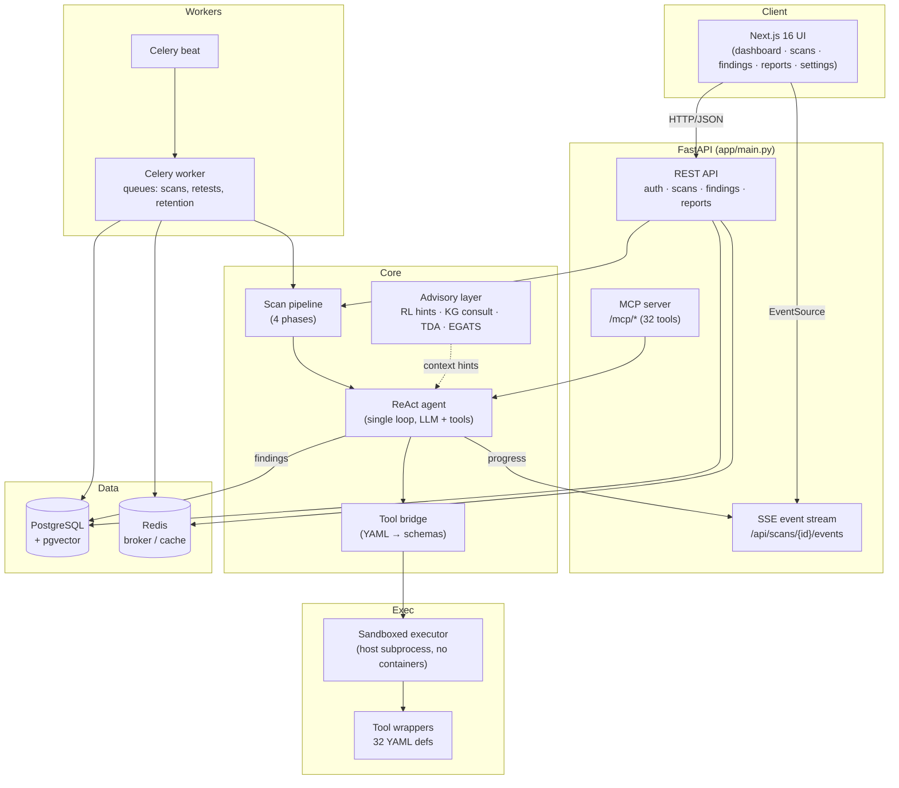

# VAPT-AI

> **AI-driven Vulnerability Assessment & Penetration Testing platform.**
> A single autonomous ReAct agent plans, executes real security tooling,
> records findings with evidence, and produces auditable reports —
> one agent, all tools, full transcript, everything auditable.

FastAPI · Next.js 16 · PostgreSQL + pgvector · Celery + Redis

---

## Table of Contents

- [What it is](#what-it-is)
- [Architecture at a glance](#architecture-at-a-glance)
- [The scan pipeline](#the-scan-pipeline)
- [The ReAct agent](#the-react-agent)
- [Advisory layer (RL · KG · TDA · EGATS)](#advisory-layer-rl--kg--tda--egats)
- [Tools](#tools)
- [Evidence, findings & reports](#evidence-findings--reports)
- [Safety & control](#safety--control)
- [Human-in-the-loop status](#human-in-the-loop-status)
- [API surface](#api-surface)
- [Web UI](#web-ui)
- [Data model](#data-model)
- [Configuration](#configuration)
- [Getting started](#getting-started)
- [Deployment](#deployment)
- [Project layout](#project-layout)
- [Current limitations](#current-limitations)
- [Security notes](#security-notes)
- [Testing](#testing)

---

## What it is

VAPT-AI automates the full Vulnerability Assessment and Penetration Testing
workflow around **one unified agent**. You give it a **target** and a
**natural-language goal**; it then:

1. Reasons about the target with an LLM in a ReAct loop (`thought` → `tool_call`),
2. Selects and runs **real offensive tooling** (`nmap`, `nuclei`, `sqlmap`,
   `ffuf`, `metasploit`, …) through a sandboxed host-subprocess executor,
3. Records **findings backed by evidence**, each with a per-finding custody
   hash chain,
4. Streams the whole process live to the UI over SSE (with an **Abort** button),
5. Emits **PDF / SARIF 2.1.0 reports** mapped to WSTG v4.2, MITRE ATT&CK,
   CWE and CVSS 3.1.

It is designed as an operator-assist platform, not an unsupervised appliance:
the agent stays in one loop, every command and every piece of evidence is
visible, and reports are reproducible from the stored transcript.

### One agent, not a swarm

Earlier iterations experimented with multi-agent orchestration (LangGraph
supervisors, specialist agents, hand-offs). **v3.2.x deliberately consolidated
everything into a single ReAct agent**: one LLM, one tool registry, one loop.
What remains of "coordination" is an *advisory layer* — RL policy hints, a
knowledge-graph consult, task-difficulty assessment and an evidence-guided
attack-tree search — that injects suggestions into the agent's context. The
agent is always free to ignore them. The `mode` parameter on the scan API is
kept purely for backward compatibility; every mode runs the same loop.

---

## Architecture at a glance



---

## The scan pipeline

`app/pentest/scan_pipeline.py` exposes a single entry point:

```python
async def run_scan_pipeline(
    *,
    target: str,
    user_prompt: str = "",
    mode: str = "auto",
    scan_id: str | None = None,
    user_id: uuid.UUID | None = None,
    findings_override: list[PipelineFinding] | None = None,
    session_factory=None,
) -> ScanPipelineResult
```

The pipeline is intentionally small — **four phases**, CyberStrikeAI-inspired:

| # | Phase | What it does |
|---|-------|--------------|
| 1 | **Init** | Registers the scan, emits the start event, creates the `Scan` DB row |
| 2 | **ReAct loop** | Single agent + all tools; LLM calls tools, records findings, calls `exit` |
| 3 | **Persist** | Writes findings, evidence and process detail to PostgreSQL |
| 4 | **Report** | Builds the report bundle (PDF / SARIF) and custody chain |

`mode` (`single_url`, `deep`, `plan_execute`) is **not used to pick a
strategy** — all modes funnel into the same single ReAct loop. The parameter
and the `app/orchestration/` selector remain for API backward compatibility.

Cancellation is cooperative: `scan_registry.is_aborted(scan_id)` is checked
before the loop, during it, and after it, so the UI **Abort** button stops work
at the next safe boundary.

`findings_override` is the test seam — inject canned findings and skip the LLM
entirely.

---

## The ReAct agent

`app/agents/react_agent.py` is the heart of the system.

```python
async def run_react_scan(
    target: str,
    user_prompt: str,
    llm_config: dict[str, Any],
    scan_id: str,
    max_iterations: int = 100,
    executor: Any = None,
) -> dict[str, Any]
```

Loop shape:

1. **Preflight** — validate the LLM config (`api_key`, `model`, `base_url`)
   before spending a single token; fail fast with a clear error.
2. **Build tool schemas once** — `build_tool_schemas()` is called a single time
   and reused each iteration (avoids per-turn rebuild cost).
3. **Create executor** — a sandboxed `SubprocessExecutor` scoped to this target
   and scan ID.
4. **Iterate** — the LLM emits `thought` → `tool_call`; the bridge executes it
   and feeds the result back. Before each turn, the advisory layer (see below)
   may prepend hints to the context. Progress is streamed via SSE at every step.
5. **Terminate** — the agent calls `exit` when the assessment is complete.

Guards baked into the loop:

- **Per-tool failure tracking** — `tool_fail_counts` circuit-breaks a tool that
  keeps failing, instead of looping forever.
- **Context pruning** — `_prune_old_tool_results()` trims stale, bulky tool
  output so long scans stay inside the context window.
- **Stall/error detection** — `_is_stall_or_error()` spots dead-end outputs.
- **Token budget warnings** — the loop warns before exhausting the budget.
- **System prompt rules** — evidence and commands must be *real*; placeholders
  such as `{{URL}}`, `<target>` or `$URL` are rejected, and the tool name must
  be genuine.

---

## Advisory layer (RL · KG · TDA · EGATS)

The agent never hands over control — instead, four components feed **context
hints** into its prompt each turn:

- **RL policy** (`app/rl/policy.py`, `q_learner.py`) — a Dueling Double DQN
  with Prioritized Experience Replay, implemented in pure NumPy (~44k
  parameters). It scores the 7 candidate actions for the current 337-dim state;
  the top choice is surfaced as an advisory hint. Hints are *shadow-gated*:
  they are recorded and evaluated but never block the agent.
- **Knowledge graph** (`app/kg/graph.py`, `advisor.py`) — an in-memory
  NetworkX graph (6 node types, 5 edge types with `success_count` /
  `probability`). It is seeded at startup with **24 skills, 119 WSTG v4.2
  tests and 44 MITRE ATT&CK techniques**, and consulted automatically after
  recon (and on demand via the `consult_kg` tool) to suggest relevant
  techniques and tests.
- **TDA** (`app/rl/tda.py`) — Task Difficulty Assessment: scores how hard the
  current sub-task is from live signals (target surface, tool failure streaks,
  progress) and tags the context accordingly.
- **EGATS** (`app/rl/egats.py`) — Evidence-Guided Attack Tree Search: a UCB1
  bandit over candidate next steps that biases hint selection toward
  high-value branches. `app/rl/self_correction.py` feeds repeated failures
  back as corrective hints.

### Cross-scan learning (RL only)

- Every agent decision is stored as a transition in the `vapt_rl_transitions`
  table; at scan end a checkpoint (`.npz` weights + SQL metadata) is written
  under `data/rl/`. This is the system's **real cross-scan learning channel** —
  the policy genuinely improves across scans.
- Training runs are **manual**: `POST /api/rl/train`.
- The knowledge graph, by contrast, is **in-session reference knowledge**: it
  is intentionally *not* persisted to PostgreSQL in this release, so the graph
  resets on restart. Long-term reuse of experience is the RL channel's job.

---

## Tools

Tools are **declarative YAML**, not code. `app/tools/loader.py` reads every
`*.yaml` and `app/agents/tool_bridge.py` turns each one into an LLM tool schema
plus an async executor.

Each definition carries the binary, its argument template, parse hints for
extracting findings, a `forbidden_args` deny-list (enforced by default — e.g.
`sqlmap` cannot pass `--os-pwn`), and an optional wordlist reference.

**32 tool wrappers ship today:**

| Category | Tools |
|----------|-------|
| Recon / enumeration | `nmap`, `masscan`, `rustscan`, `fscan`, `httpx`, `whatweb`, `dnsenum`, `fierce`, `amass`, `subfinder`, `theharvester`, `gau`, `waybackurls` |
| Web fuzzing / scanning | `ffuf`, `feroxbuster`, `gobuster`, `katana`, `nuclei`, `nikto`, `dalfox`, `wpscan`, `sqlmap` |
| Credentials / exploitation | `hydra`, `john`, `hashcat`, `metasploit`, `impacket`, `netexec`, `responder` |
| Post-exploitation | `linpeas`, `winpeas`, `mimikatz` |

The Metasploit integration runs through **`msfconsole -q -x`** subprocesses.
An MSF RPC client also exists in the codebase, but its tools are currently
commented out (`app/main.py`) — msfconsole is the active channel.

Wordlists live under `data/wordlists/`; `loader._resolve_wordlist()` resolves
logical names to real paths.

---

## Evidence, findings & reports

- **Evidence** is written exclusively through the `record_vulnerability` tool
  (`app/agents/tool_bridge.py`), which also sanitises placeholders out of
  commands and evidence.
- **Custody** — `app/evidence/custody.py` maintains a per-finding HMAC hash
  chain so any tampering is detectable; `/api/findings/{id}/custody-chain` and
  `/api/scans/{id}/custody-verify` expose verification.
- **Verification is plausibility-based** (`app/evidence/verifier.py`): a
  rule-based checker looks for tool-specific markers (e.g. sqlmap's
  "is vulnerable", dalfox's `[V]`), rejects placeholder output, and grades
  evidence as `plausible` (0.5) or `confirmed` (0.8). A `replay_verified`
  (1.0) level is defined but **currently unreachable** — there is no
  re-execution path, and no second-LLM audit. Findings with attached evidence
  are marked verified automatically in the final pipeline phase.
- **CVSS** scoring is handled in `app/evidence/cvss.py`.
- **Standards mapping** — WSTG v4.2 (119 tests), MITRE ATT&CK (44 techniques),
  CWE and CVSS 3.1 are seeded at startup and attached to findings from the
  LLM's own declaration (pass-through mapping, not yet auto-derived).
- **Reports** — `app/report/collector.py` gathers scan + findings + evidence +
  audit into `FindingReportData`, then:
  - `pdf_exporter.py` (ReportLab) renders the human report, with a
    *Proof of Concept* section that falls back from exploitation to detection,
  - `sarif_exporter.py` emits machine-readable SARIF 2.1.0 for CI pipelines.

> Severity is stored as a **string**, so it is never used in `ORDER BY`;
> ranking is done in Python via `_SEVERITY_RANK`.

---

## Safety & control

- **Sandbox** (`app/sandbox/`) — tools run as **host subprocesses**, not
  containers: each command gets its own process group (`setsid`), a hard
  timeout that kills the whole group, and a 50KB output cap. Isolation is
  process-level only — run the platform on a dedicated, boundary-controlled
  host.
- **Forbidden arguments** (default **ON**) — per-tool deny-lists from the YAML
  definitions block the most dangerous flags before execution.
- **Scope guard** (`app/sandbox/scope_guard.py`) — a 3-layer design (tool
  args → command rewrite → declared-scope check) ships **disabled by default**
  (`VAPT_AI_SCOPE_GUARD_DISABLED=1`, declared scope permissive). Enable it and
  declare a scope for any real engagement.
- **Audit log** (`app/audit/logger.py`) — append-only HMAC hash chain with a
  `GET /api/audit/verify-chain` integrity endpoint. Event coverage is
  currently narrow (mainly scope violations), not a full action trail.
- **Consent** (`app/consent/manager.py`) — model and endpoints exist
  (`/api/consent/*`), but **verification is a stub and scan start does not
  enforce consent**. Authorisation is the operator's responsibility.

---

## Human-in-the-loop status

HITL was **designed end-to-end** (DB model, approval gate, endpoints, UI
modal, audit-agent env vars) but is **disabled by default and currently
non-functional**:

- `VAPT_AI_HITL_DISABLED=1` (default) short-circuits the gate to "allow";
  even when re-enabled, the approval path is dead code.
- `POST /api/hitl/{id}/approve` and `POST /api/hitl/{id}/abort` return
  **`410 Gone`**.
- The UI approval modal is disabled.

Treat HITL as future work; today the practical safety layers are the
sandbox, forbidden-argument checks, and operator supervision.

---

## API surface

The FastAPI app is built by `create_app()` in `app/main.py`. Highlights:

| Group | Endpoints |
|-------|-----------|
| **System** | `GET /health`, `GET /api/sanitizer/patterns` |
| **Auth** | `auth_router` (JWT, `HTTPBearer`) |
| **Scans** | `scan_router`, `GET /api/scans/active`, `POST /api/scans/{id}/abort`, `GET /api/scans/{id}/events` (SSE) |
| **Blackboard** | `GET /api/scans/{id}/blackboard`, `GET /api/scans/{id}/facts` |
| **HITL** | `GET /api/hitl/pending/{scan_id}`, `POST /api/hitl/{id}/approve` ⚠️ `410 Gone`, `POST /api/hitl/{id}/abort` ⚠️ `410 Gone` |
| **Findings** | `GET /api/findings/{id}`, `GET /api/findings/{id}/custody-chain` |
| **Evidence** | `GET /api/evidence/{id}/verify`, `GET /api/scans/{id}/custody-verify` |
| **Consent** | `POST /api/consent/create`, `.../accept-tos`, `.../verify` (stub), `GET /api/consent/scan/{id}` |
| **Audit** | `GET /api/audit/entries`, `GET /api/audit/verify-chain`, `GET /api/audit/stats` |
| **MCP** | `GET /mcp/tools/list`, `GET /mcp/health`, `GET /mcp/tools/definitions`, `GET /api/mcp/executions` |
| **Conversations** | `conversation_router` |
| **Methodology** | `create_methodology_router(...)` |
| **Settings** | `settings_router` |
| **Orchestration** | `orch_router` (back-compat, single loop) |
| **History** | `scans_history_router` |
| **Vulnerabilities** | `vulns_router` |
| **Knowledge graph** | `kg_router` |
| **Trace** | `trace_router` |
| **RL** | `rl_router` (incl. `POST /api/rl/train`) |
| **Channels** | `channels_router` |

Interactive docs are served at `/docs` and the schema at `/openapi.json`.
The **MCP server** exposes the same 32 tools to external MCP clients.

---

## Web UI

Single Next.js 16 SPA (`frontend/`):

| View | What it does |
|------|--------------|
| **Login** | JWT session against the single admin account |
| **Dashboard** | Overview stats |
| **Scans** | Start scans, live SSE transcript, **Abort** |
| **Findings** | Findings list + detail with evidence and custody info |
| **Reports** | Report history, PDF / SARIF download |
| **Settings** | AI channels (provider, model, keys) |

Not present in the UI (API-only or disabled): knowledge-graph and RL views,
consent flow, HITL approval modal (disabled).

---

## Data model

SQLAlchemy 2.0 async models in `app/db/models/`:

`user.py` · `scan.py` · `conversation.py` · `pentest.py` · evidence-related ·
`attack_catalog.py` · `attackchain.py` · `methodology.py` · `hitl.py` ·
`process_detail.py` · `replay.py` · `rl.py` · `kg.py` · `audit.py` · `c2.py`

Notes:

- `hitl.py` and `kg.py` tables exist in the schema, but their runtime
  write-paths are intentionally dormant (HITL disabled; KG persistence skipped
  in this release).
- `rl.py` is live — transitions and checkpoints are written on every scan.

Sessions: `app/db/session.py` (async, asyncpg — canonical runtime) and
`app/db/sync_session.py` (sync, psycopg2 — Alembic + scripts).
Migrations live in `alembic/versions/` (baseline `0001` → `0009`).

---

## Configuration

Two layers:

1. **`.env`** — process/environment settings (admin credentials, JWT secret,
   DB URL, Redis URL, feature flags). Canonical vars are prefixed
   `VAPT_AI_*`; `EVVO_*` names remain as legacy aliases, and `MSF_RPC_*`
   configures the (currently disabled) Metasploit RPC channel.
2. **`config.yaml`** — LLM channels, loaded and saved atomically by
   `app/core/channels.py`. This is the **single source of truth** for AI
   channels and is editable from the Settings UI.

Example channel:

```yaml
default_channel: deepseek
ai:
  channels:
    deepseek:
      provider: openai_compatible
      base_url: https://api.deepseek.com/v1
      model: deepseek-flash
      max_total_tokens: 128000
      max_completion_tokens: 4096
      temperature: 0.7
```

Both `config.yaml` and `.env` are **gitignored** — keep them that way.
Start from `.env.example`.

---

## Getting started

### Prerequisites

- Python 3.12+
- Node.js 20+
- PostgreSQL 15+ with the `pgvector` extension
- Redis 7+
- The offensive tools you intend to use, on `PATH` (or install via
  `scripts/install_tools.sh` / `scripts/install_tools_extended.sh`)

### Backend

```bash
python -m venv venv && source venv/bin/activate
pip install -r requirements.txt
cp .env.example .env            # then edit credentials
alembic upgrade head            # create the schema
uvicorn app.main:app --reload --port 8000
```

### Frontend

```bash
cd frontend
npm install
npm run dev                     # http://localhost:3000
```

In development `next.config.ts` rewrites `/api/*`, `/mcp/*`, `/docs`,
`/health` and `/openapi.json` to the backend on `:8000`.

### First scan

1. Open the UI and log in.
2. Go to **Settings → AI Channels** and add a provider + API key.
3. Start a scan with a target and a goal, e.g.
   *"Enumerate this web app and test for injection flaws."*
4. Watch the live transcript; review findings, evidence and the report.

---

## Deployment

Production services are defined under `scripts/systemd/`:

| Unit | Role |
|------|------|
| `vapt-ai-app.service` | uvicorn API (single worker) |
| `vapt-ai-celery-worker.service` | Celery worker — `-Q scans,retests,retention` |
| `vapt-ai-celery-beat.service` | Celery beat scheduler |
| `msfrpcd.service` | Metasploit RPC daemon (unit ships, but the RPC client tools are currently disabled — `msfconsole` is the active channel) |

`scripts/setup_systemd.sh` installs and enables them.

> **Single-worker caveat:** the API runs one uvicorn worker. Any blocking call
> inside an async handler stalls *every* request, including `/api/auth/login`.
> Keep blocking work off the event loop (or in Celery).

---

## Project layout

```
app/
├── main.py              # FastAPI app factory + inline routes
├── core/                # config, LLM transport, channels, CVE client, sanitizer
├── agents/              # ReAct agent, tool bridge, LLM shim, call caps/cache
├── pentest/             # scan pipeline, blackboard, SSE events, registry
├── tools/               # 32 YAML tool wrappers + loader (forbidden-args enforcement)
├── skills/              # 24 markdown playbooks (web, recon, AD, priv-esc, …)
├── orchestration/       # mode selector + base orchestrator (single-loop back-compat)
├── routes/              # modular routers (scans, findings, kg, rl, trace, …)
├── evidence/            # custody chain, plausibility verifier, CVSS, finding state
├── report/              # collector, PDF + SARIF exporters
├── methodology/         # WSTG + ATT&CK catalogs, startup seeding
├── auth/                # JWT manager
├── consent/ audit/      # consent manager + hash-chained audit log
├── kg/                  # in-memory NetworkX knowledge graph, advisor, seeder
├── rl/                  # DQN policy, TDA, EGATS, experience store, training
├── mcp/                 # MCP server exposing the 32 tools
├── db/                  # SQLAlchemy models + session factories
└── harness/ sandbox/    # subprocess execution + host isolation + scope guard
workers/                 # Celery app + scan tasks
alembic/                 # migrations (0001 → 0009)
data/                    # wordlists, catalogs, RL checkpoints, traces
frontend/                # Next.js 16 + Tailwind + shadcn/ui
scripts/systemd/         # production service units
tests/                   # unit, integration, vapt
```

---

## Current limitations

Honest list, by design:

- **Single agent by design.** No multi-agent swarm; advisory hints are
  suggestions, not orchestration.
- **HITL is disabled** and its approval path is dead code (see
  [Human-in-the-loop status](#human-in-the-loop-status)).
- **The knowledge graph is in-memory** and resets on restart; persistence is
  intentionally skipped in this release. Cross-scan learning happens only
  through the RL checkpoint channel.
- **Evidence verification is plausibility-based** — no re-execution and no
  second-LLM audit; `replay_verified` is unreachable today.
- **The scope guard ships off**; forbidden-argument checks are the active
  tool-level guard.
- **Consent is not enforced** at scan start and its verification is a stub.
- **No containerization** — sandboxing is host-process-level only.
- **Metasploit RPC is disabled**; `msfconsole -q -x` is the active channel.
- **Audit event coverage is narrow** (not a full user/action trail).
- **One uvicorn worker** — keep blocking work off the event loop.

---

## Security notes

- **Never commit `config.yaml` or `.env`** — they hold live API keys and
  secrets. Both are already gitignored.
- Review `.env.example` before publishing — it is tracked. In particular,
  `MSF_RPC_PASSWORD` currently ships with a non-placeholder value; change it
  and rotate any key that has ever been committed or written to disk in
  plaintext.
- Scope-related defaults are permissive: `VAPT_AI_SCOPE_GUARD_DISABLED=1` and
  `VAPT_AI_HITL_DISABLED=1`. For any real engagement, enable the scope guard,
  declare your scope, and keep a human in the loop outside the tool.
- VAPT-AI runs real offensive tooling. Only use it against systems you are
  explicitly authorised to test.

---

## Testing

```bash
pytest                       # config in pytest.ini
pytest tests/unit            # fast unit tests
pytest tests/integration     # end-to-end
python scripts/tools_smoke_test.py   # verify installed tools
```

---

## License

See the repository for licensing terms. Use responsibly and only on
authorised targets.